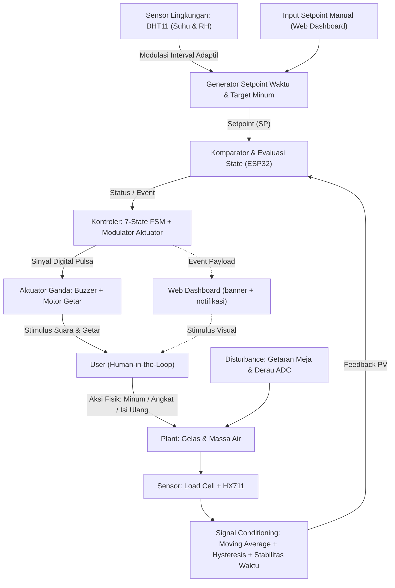
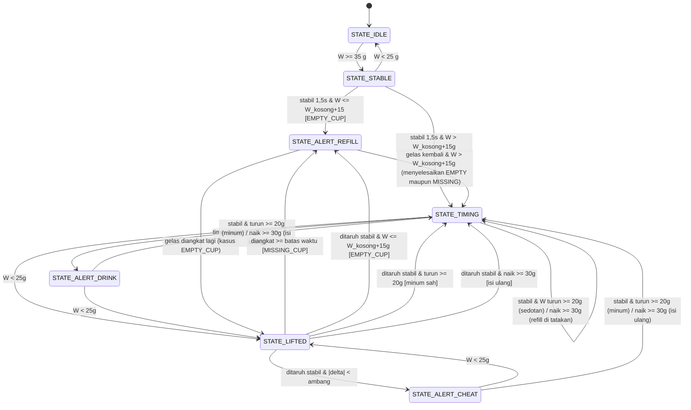

# PRODUCT REQUIREMENTS DOCUMENT (PRD) & SPESIFIKASI TEKNIS — FINAL
## Smart Hydration Coaster: Sistem Kendali & Pemantau Hidrasi Adaptif
**Versi:** 2.0 FINAL (keputusan terkunci, 2026-10-07)
**Target Mata Kuliah:** RSK-352 Sistem Kendali (2 SKS) & RSK-354 Internet of Things (3 SKS)
**Program Studi:** S1 Rekayasa Sistem Komputer, FMIPA Universitas Tanjungpura
**Dasar revisi:** hasil audit teknis 2026-10-05 (`AUDIT_Smart_Hydration_Coaster.md`). Semua keputusan pada dokumen ini final dan mengikat implementasi kode.

---

## 1. Gambaran Umum dan Tujuan Sistem

Smart Hydration Coaster adalah tatakan gelas pintar berbasis ESP32 yang mendisiplinkan konsumsi air minum melalui verifikasi berat fisik secara *closed-loop* dan adaptasi suhu ruangan.

Aplikasi pengingat minum di ponsel bekerja *open-loop*: alarm berbunyi tanpa verifikasi apakah user benar-benar minum. Sistem ini menutup umpan balik tersebut dengan memantau berat gelas di atas tatakan (load cell + HX711), mendeteksi percobaan *anti-cheat*, mengenali gelas kosong dan gelas yang lupa dikembalikan, serta memodulasi durasi timer dari suhu dan kelembaban ruangan (DHT11). Pemantauan dan laporan harian tampil pada *web dashboard*.

---

## 2. Spesifikasi Perangkat Keras

### 2.1 Sensor
1. **Load Cell 1 kg / 5 kg + modul ADC HX711 24-bit.** Mengukur massa total gelas + air dalam gram secara real-time. Prinsip: perubahan resistansi jembatan Wheatstone diperkuat PGA internal HX711, dikonversi 24-bit.
2. **DHT11** (suhu 0–50 °C, RH 20–90%). Variabel input lingkungan untuk memodulasi durasi timer pada mode adaptif.

### 2.2 Aktuator (keduanya modul dengan driver onboard)
1. **Modul Active Buzzer 3-pin** (VCC/GND/I-O). Modul sudah berisi transistor PNP S8550 + resistor base onboard, sehingga pin GPIO hanya menggerakkan basis transistor. **Polaritas ACTIVE-LOW** (tanda `低电平触发`: LOW = bunyi). Tidak perlu transistor, resistor, atau dioda eksternal.
2. **Modul Vibration Motor DC (motor koin) 3-pin** (VCC/GND/IN). Modul sudah berisi transistor NPN S8050 + resistor onboard; arus motor 60–90 mA tidak melewati pin GPIO. **Active-HIGH** (HIGH = getar) dan mendukung PWM. Firmware memakai pola pulsing digital on/off; kemampuan PWM modul dicatat sebagai cadangan, bukan klaim implementasi.

### 2.3 Tabel Pinout ESP32 DevKit V1

| Komponen | Kaki modul | Pin ESP32 | Arah | Keterangan |
| :--- | :--- | :--- | :--- | :--- |
| HX711 | DT/DOUT | **GPIO 16** | Input | Data ADC 24-bit; DOUT high ≈ DVDD 2,6 V (aman untuk 3,3 V) |
| | SCK/CLK | **GPIO 4** | Output | Clock sinkronisasi |
| | VCC/GND | VIN 5V / GND | Daya | Eksitasi load cell |
| DHT11 | DATA | **GPIO 19** | I/O | Single-wire; VCC 3,3 V |
| Buzzer (modul) | I-O | **GPIO 18** | Output | **Active-LOW** (PNP S8550); **VCC wajib 3,3 V** agar transistor mati saat GPIO HIGH (3,3 V) |
| Motor getar (modul) | IN | **GPIO 17** | Output | **Active-HIGH** (NPN S8050); VCC ke VIN 5 V, GPIO2 dihindari karena strapping pin + LED onboard |

Catatan desain: motor dipindah dari GPIO2 (strapping pin, berbagi LED onboard) ke GPIO17 agar boot ESP32 tidak memicu getaran parasit.

---

## 3. Skenario Operasional (8 skenario; 6 di antaranya wajib sesuai requirement)

Stabilitas di seluruh dokumen dan kode didefinisikan tunggal: **berat dalam band ±3 g dari kandidat stabil selama 1.500 ms** (`STABILITY_TIME_MS = 1500`, `STABILITY_BAND = 3.0`), dievaluasi per sampel 100 ms. Ini angka yang sama di firmware, Python test, dan web.

1. **Peletakan gelas berisi air.** Gelas ditaruh, berat ≥ 35 g masuk STABLE; setelah stabil 1,5 s dan berat > W_kosong + 15 g, berat disimpan sebagai baseline dan timer dimulai.
2. **Durasi timer (manual vs adaptif).** Manual: nilai menit dari dashboard. Adaptif: dihitung dari DHT11 (§4.3).
3. **`STATE_ALERT_DRINK`:** timer habis tanpa minum → buzzer + motor berpola 500 ms ON/500 ms OFF sampai gelas diangkat, plus banner + notifikasi web.
4. **Minum sah:** angkat → taruh kembali dengan ΔW turun ≥ 20 g dan air tersisa → alarm mati, volume ditambah ke akumulasi harian, baseline diperbarui, timer di-reset.
5. **`STATE_ALERT_CHEAT`:** gelas ditaruh kembali dengan ΔW < 20 g → buzzer + motor berpola 150 ms ON/150 ms OFF sampai gelas diangkat lagi untuk minum sungguhan.
6. **`STATE_ALERT_REFILL` (gelas kosong):** gelas ditaruh dengan 35 g ≤ W ≤ W_kosong + 15 g → alarm isi ulang (750 ms ON/750 ms OFF) sampai diisi ulang.
7. **`STATE_ALERT_REFILL` (gelas hilang):** gelas diangkat > `MAX_LIFT_DURATION_MS` (3 menit normal / 10 detik demo) → alarm lupa-gelas. Alarm hanya selesai jika gelas kembali: berisi air → TIMING; kosong → berpindah ke alert gelas kosong (alarm tetap aktif, tidak pernah hilang tanpa resolusi).
8. **Minum via sedotan / isi ulang di atas tatakan:** tanpa mengangkat gelas, ΔW turun ≥ 20 g dicatat sebagai minum; ΔW naik ≥ 30 g dicatat sebagai isi ulang; keduanya memperbarui baseline dan me-reset timer.

---

## 4. Arsitektur Sistem Kendali (RSK-352)

### 4.1 Variabel Kendali (Human-in-the-Loop)
- **PV:** massa air di gelas (W_total − W_kosong) dan waktu tunggu sejak tegukan terakhir.
- **SP:** pengurangan massa minimal ΔW ≥ 20 g dalam batas waktu T_target.
- **Environmental input:** suhu dan RH dari DHT11 yang memodulasi T_target.
- **MV:** sinyal digital on/off dua aktuator dengan pola modulasi per status (§4.5). Modul motor PWM-capable; firmware memakai pulsing digital.
- **Disturbance:** getaran meja, derau ADC HX711, hentakan peletakan. Diredam Moving Average Filter (jendela 10 sampel, sampel 10 Hz) + hysteresis CUP_ON 35 g / CUP_OFF 25 g + stabilitas berbasis waktu 1,5 s.

### 4.2 Diagram Blok Closed-Loop



### 4.3 Kendali Adaptif Berbasis Aturan (bukan Fuzzy)

Nama resmi: **kontroler adaptif rule-based**. `adaptive_controller.h` (nama baru, sebelumnya `fuzzy_controller.h`) berisi fungsi deterministik berbasis ambang, tanpa fuzzyfikasi/inferensi/defuzzifikasi. Dokumen tidak lagi mengklaim FLC Sugeno.

$$T_{target} = \max(5 \text{ detik},\ T_{base} \times k_{temp} \times k_{hum})$$

| Kondisi | Faktor |
| :--- | :--- |
| T < 24 °C | k_temp = 1,20 |
| 24–28 °C | k_temp = 1,00 |
| 28–32 °C | k_temp = 0,75 |
| > 32 °C | k_temp = 0,50 |
| RH < 40 % | k_hum = 0,85 |
| RH ≥ 40 % | k_hum = 1,00 |

Contoh T_base 30 menit: 33 °C/45 % → 15,00 menit; 22 °C/75 % → 36,00 menit. Rumus ini identik di firmware, `test_simulation.py`, dan web (satu tabel konstanta, lihat §6.4).

### 4.4 FSM 7-State (stabilitas berbasis waktu)



Semantik "stabil": kandidat berat disimpan saat berat berubah >3 g; transisi terjadi hanya bila berat bertahan dalam ±3 g selama 1.500 ms. Timer stabilitas di-reset di setiap perpindahan state. Semua arah naik/turun pada setiap state mengikuti satu tabel transisi (ΔW turun ≥ 20 g = minum, naik ≥ 30 g = isi ulang).

**Setiap keputusan ΔW wajib menunggu berat baru stabil.** Cabang minum dan isi ulang di `STATE_TIMING`, `STATE_ALERT_DRINK`, dan `STATE_ALERT_CHEAT` tidak boleh dieksekusi pada sampel pertama yang melewati ambang; ia menunggu dulu `isStable()` terpenuhi untuk berat baru. Alasannya fisik: mengangkat gelas bukan satu langkah, melainkan turun bertahap sekitar 46 g per sampel pada 10 Hz. Tanpa gerbang ini, delapan sampel saat mengangkat gelas terbaca sebagai delapan kali minum berturut-turut (pernah terukur 4–6 minum palsu per pengangkatan, total melonjak ke 276 g), timer terus ter-reset sehingga `ALERT_DRINK` tidak pernah muncul, baseline ikut rusak ke nilai terangkat, dan `ALERT_CHEAT` menjadi mustahil dicapai karena selisihnya selalu terbaca sebagai minum sah. Gerbang yang sama berlaku untuk sedotan, isi ulang di atas tatakan, dan pemulihan dari `ALERT_REFILL`.

### 4.5 Pola Modulasi Aktuator

Firmware memakai pulsing non-blocking; fase toggle di-reset setiap kali masuk atau keluar mode alert agar ketukan pertama selalu konsisten. Buzzer active-LOW dan motor active-HIGH digerakkan lewat helper `writeActuator(pin, on, activeLow)` sehingga polaritas masing-masing modul dijaga konstanta.

| Status | Pola | Pesan |
| :--- | :--- | :--- |
| `ALERT_DRINK` | 500 ms ON / 500 ms OFF | "Waktunya minum!" |
| `ALERT_CHEAT` | 150 ms ON / 150 ms OFF | "Berat hanya turun < 20 g, minum yang sungguhan." |
| `ALERT_EMPTY_CUP` | 750 ms ON / 750 ms OFF | "Air habis, isi ulang." |
| `ALERT_MISSING_CUP` | 750 ms ON / 750 ms OFF | "Gelas belum kembali ke tatakan." |

Notifikasi web dikirim satu kali per perubahan jenis alert (bukan berulang); banner tetap tampil selama alert aktif.

---

## 5. Arsitektur IoT & Protokol Komunikasi (RSK-354)

> **Status:** Phase 2. Fase 1 berjalan standalone (Serial + simulator web). Integrasi dimulai setelah kalibrasi load cell selesai.

### 5.1 Protokol di sisi ESP32 (jawaban definitif)
- **Transport:** Wi-Fi mode STA, 2,4 GHz (ESP32 tidak mendukung 5 GHz).
- **Protokol:** HTTPS REST ke Firebase Realtime Database, port 443, body JSON.
- **Implementasi firmware:** library **Firebase ESP Client (Mobizt)**, karena menangani token autentikasi dan reconnect secara otomatis. Alternatif tanpa library: `HTTPClient` + `WiFiClientSecure`, tetapi harus menulis alur token sendiri.
- **Endpoint:**

| Arah | Operasi | Path | Kapan |
| :--- | :--- | :--- | :--- |
| ESP32 → cloud | PATCH | `/smart_coaster/telemetry.json` | saat transisi state + heartbeat tiap 10 s |
| ESP32 → cloud | PATCH | `/smart_coaster/daily/{YYYY-MM-DD}/...` | tiap event minum/refill/cheat |
| ESP32 ← cloud | GET | `/smart_coaster/config.json` | saat boot + tiap 30 detik |
| Browser ↔ cloud | SDK `onValue` (WSS) | `/smart_coaster` | realtime |

- **Kadens dikendalikan:** push tidak dilakukan per iterasi loop; cukup on-change + heartbeat 10 s agar aman terhadap kuota Spark.
- **Auth:** Fase 2 tanpa login (satu perangkat, rules terbuka terkontrol). Anonymous Auth opsional untuk merapikan rules. Email/password hanya jika kelak multi-user.

### 5.2 Skema Database

```json
{
  "smart_coaster": {
    "telemetry": { "weight_g": 380.0, "water_ml": 250.0, "temp_c": 28.5, "humidity_pct": 62.0,
                   "fsm_state": "TIMING", "alert_reason": "NONE", "remaining_sec": 1420, "target_interval_min": 22.5 },
    "daily": {
      "2026-10-07": { "total_ml": 735, "drink_count": 3, "refill_count": 2, "cheat_count": 1 }
    },
    "config": { "timer_mode": "AUTO_DHT", "manual_interval_min": 30, "empty_cup_weight_g": 130, "min_drink_delta_g": 20, "max_lift_duration_sec": 180 },
    "logs": [ { "time": "14:20:10", "event": "Minum 245 ml", "drink_ml": 245 } ]
  }
}
```

Laporan harian berkunci tanggal sehingga hari baru otomatis membuka node baru; tidak perlu cron reset, dan node lama menjadi riwayat.

---

## 6. Spesifikasi Web Dashboard (`web/index.html`)

1. **Kartu telemetri:** berat total, volume air, suhu/RH, countdown berdetak (MM:SS berjalan tiap detik via `setInterval`, bukan angka statis), interval target.
2. **Banner alert + Web Notification:** notifikasi browser satu kali per peringatan; warna banner per jenis alert.
3. **Laporan harian:** tabel riwayat event, total ml, persen target harian, Minum Nx / Refill Nx / Cheat Nx, tombol reset statistik. **drinkCount bertambah pada setiap minum sah**, bukan hanya saat gelas kosong.
4. **Panel konfigurasi:** mode AUTO_DHT/MANUAL, interval basis/manual, berat gelas kosong. Interval adaptif **dihitung ulang otomatis** setiap kali suhu/RH berubah (bukan hanya saat tombol simpan).
5. **Simulator FSM:** halaman memuat port 1:1 dari `fsm.h` (state, ambang, stabilitas berbasis waktu, semua cabang). Tombol skenario memicu **urutan sampel berat** melalui mesin FSM itu, bukan sekadar mengganti label state. Konstanta diambil dari satu objek `CONFIG` yang isinya sama dengan `config.h`; perbedaan apa pun antara keduanya adalah bug.
6. **Mode koneksi:** Fase 1 = simulator mandiri. Fase 2 = nilai state diisi dari Firebase SDK; logika FSM dan tampilan tidak berubah.

---

## 7. Struktur Codebase

```
SmartHydrationCoaster/          <- sketch utama; buka folder ini di Arduino IDE
    SmartHydrationCoaster.ino   <- firmware utama (bekas main.ino)
    config.h                    <- pin, ambang, konstanta waktu, polaritas aktuator
    filter.h                    <- moving average
    adaptive_controller.h       <- kendali adaptif berbasis aturan (nama baru)
    fsm.h                       <- 7-state FSM
tools/
    kalibrasi/kalibrasi.ino
    test_hardware/test_hardware.ino
    test_loadcell/test_loadcell.ino
test_simulation.py              <- port 1:1 dari fsm.h; sumber kebenaran uji otomatis
web/index.html
docs/pemodelan_sistem_kendali.md
PRD_Smart_Hydration_Coaster.md  <- dokumen ini
AUDIT_Smart_Hydration_Coaster.md
```

Aturan sketch Arduino: satu sketch = satu folder, nama file `.ino` wajib sama dengan nama folder. Skrip uji (`kalibrasi`, `test_hardware`, `test_loadcell`) masing-masing berdiri sebagai sketch sendiri di `tools/`.

---

## 8. Casing PVC Foam Board 5 mm

1. **Sandwich tiga lapis:** alas 12x12 cm (load cell dibaut M4, diganjal 2 washer ≈ 2 mm), batang load cell menggantung dengan celah ±2 mm, piringan atas 11x11 cm dengan modul motor getar ditempel double tape foam di permukaan bawahnya.
2. **DHT11** menghadap keluar pada dinding samping dengan lubang sirkulasi, jauh dari panas regulator ESP32.

---

## 9. Pengujian dan Kriteria Penerimaan

| # | Skenario | Uji otomatis | Uji manual |
| :--- | :--- | :--- | :--- |
| 1 | Timer adaptif DHT11 (33 °C/45 % → 15,00 mnt; 22 °C/75 % → 36,00 mnt) | `test_simulation.py` | bandingkan Serial Monitor vs dashboard |
| 2 | Taruh gelas → TIMING setelah stabil 1,5 s | idem | taruh gelas 380 g |
| 3 | Timer habis → ALERT_DRINK (pola 500/500) | idem | dengar/rapu pola bunyi |
| 4 | Anti-cheat ΔW < 20 g → ALERT_CHEAT (pola 150/150) | idem | sentuh gelas tanpa minum |
| 5 | Minum sah → timer reset, total naik, drinkCount +1 | idem | minum ≥ 20 g |
| 6 | Gelas kosong → ALERT_EMPTY_CUP | idem | taruh gelas kosong |
| 7 | Gelas diangkat > batas → ALERT_MISSING_CUP; pulih saat gelas kembali | idem | angkat > 3 mnt (10 s demo) |
| 8 | Sedotan (−20 g) & tuang langsung (+30 g) di atas tatakan | idem | uji manual |
| 9 | Hysteresis CUP_ON/CUP_OFF 35/25 g | idem | angkat-taruh berulang di dekat ambang |
| 10 | Regresi angkat bertahap (−46 g/sampel): 0 minum palsu, baseline utuh, lanjut ke ALERT_CHEAT | idem | angkat gelas penuh lalu taruh kembali tanpa minum |

Skenario 10 wajib ada karena skenario 2–9 semuanya mengangkat gelas dalam satu langkah, sehingga cacat "keputusan ΔW tanpa gerbang stabilitas" lolos dari seluruh rangkaian uji tersebut. Tanpa gerbang itu, skenario 10 gagal dengan 6 minum palsu dan total 276 g sementara skenario 1–9 tetap hijau.

Tiga port harus lulus skenario yang sama: `test_simulation.py` (15 skenario), `tools/uji_fsm/uji_fsm.cpp` (mengompilasi `fsm.h` asli di PC, 21 pemeriksaan), dan `web/index.html` (8 tombol skenario). Prosedur kalibrasi: `tools/kalibrasi` dengan beban dikenal, catat faktor, samakan di semua berkas. **Klaim reduksi derau hanya boleh ditulis setelah `run_noise_test()` menghasilkan data nyata.** Faktor kalibrasi di `config.h` bernilai 290.0f hasil pengukuran `tools/test_loadcell`; nilainya tetap harus diulang ulang bila load cell dipindah atau rangka diganti.

---

## 10. Roadmap & Batasan yang Diketahui

- **Phase 1 (sekarang):** firmware standalone + simulator web; perbaikan hasil audit sudah diterapkan (stabilitas berbasis waktu, reset saat transisi, polaritas aktuator, motor di GPIO17, validasi berat, struktur sketch).
- **Phase 2:** Wi-Fi + Firebase REST + Hosting + notifikasi HTTPS, sesuai §5.
- **Batasan yang diakui terbuka:** berat gelas kosong tidak persist antar reboot (RAM saja); `demoMode` default AKTIF 15 detik untuk kelas, dimatikan dengan perintah serial `'d'` saat pengujian nyata; derau sensor menunggu pengukuran kalibrasi.

---

## 11. Perubahan Keputusan penting dibanding draft (ringkas)

Motor pindah GPIO2 → GPIO17. Interval dasar dikunci 30 menit. Stabilitas berbasis waktu 1,5 s ±3 g (bukan hitung sampel). Polaritas aktuator terdokumentasi (buzzer active-LOW, motor active-HIGH) dengan helper `writeActuator`. Nama `fuzzy_controller.h` → `adaptive_controller.h` dan klaim Fuzzy Sugeno dihapus. Struktur sketch dirapikan agar dapat dikompilasi. Protokol komunikasi ditetapkan: HTTPS REST Firebase RTDB via library Mobizt.

Ditambahkan setelah uji perangkat nyata 2026-10-08: setiap keputusan ΔW (minum, sedotan, isi ulang di tatakan, pemulihan dari ALERT_REFILL) menunggu berat baru stabil lebih dulu. Sebelumnya keputusan diambil pada sampel pertama yang melewati ambang, sehingga mengangkat gelas penuh menghasilkan deretan minum palsu, merusak baseline, dan membuat ALERT_CHEAT tidak pernah bisa tercapai di perangkat. Perubahan ini diterapkan serentak di `fsm.h`, `test_simulation.py`, dan `web/index.html` beserta skenario regresi barunya.
