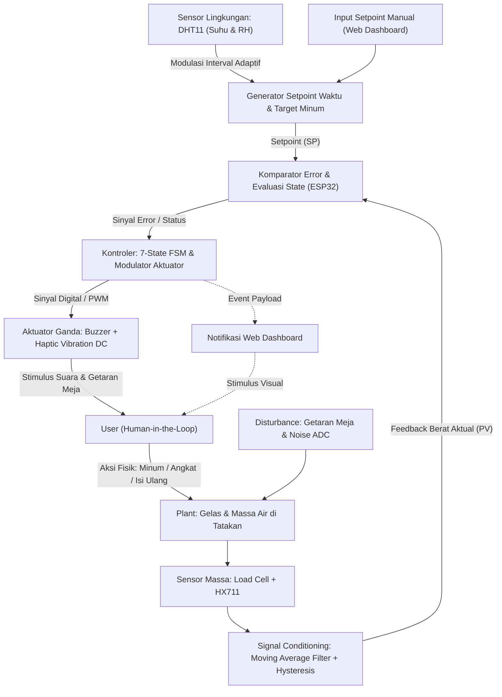
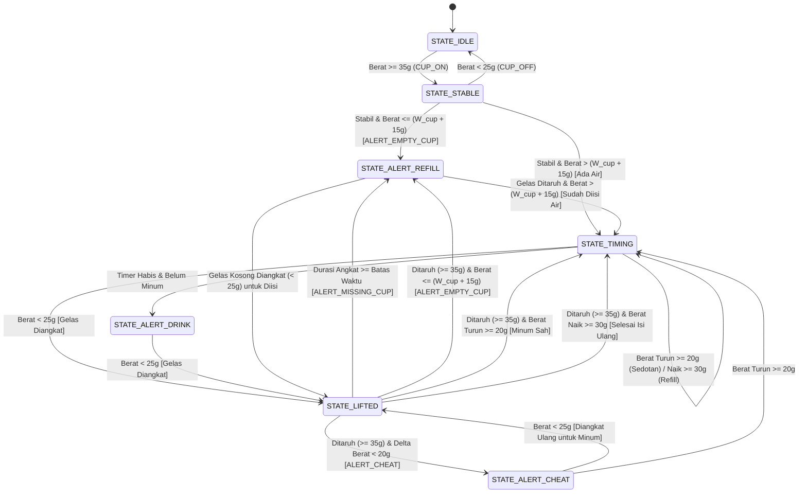

# PRODUCT REQUIREMENTS DOCUMENT (PRD) & SPESIFIKASI TEKNIS
## Smart Hydration Coaster: Sistem Kendali & Pemantau Hidrasi Adaptif
**Target Mata Kuliah:** RSK-352 Sistem Kendali (2 SKS) & RSK-354 Internet of Things (3 SKS)  
**Program Studi:** S1 Rekayasa Sistem Komputer, FMIPA Universitas Tanjungpura  
**Platform Utama:** ESP32 DevKit V1, Load Cell + HX711, DHT11, Haptic Vibration Motor DC, Active Buzzer, Firebase Realtime Database, Web Dashboard

---

## 1. Gambaran Umum dan Tujuan Sistem

Smart Hydration Coaster adalah perangkat tatakan gelas pintar yang mendisiplinkan konsumsi air minum *user* di meja kerja melalui verifikasi berat fisik secara *closed-loop* dan adaptasi suhu ruangan.

Aplikasi pengingat minum di ponsel bekerja secara *open-loop* karena hanya membunyikan alarm tanpa memverifikasi apakah *user* benar-benar minum. Sistem ini menutup umpan balik tersebut dengan memantau keberadaan gelas di atas tatakan, mendeteksi percobaan *anti-cheat*, mengenali kondisi gelas kosong, serta menghitung durasi *timer* secara adaptif berdasarkan suhu dan kelembaban ruangan dari sensor DHT11.

---

## 2. Spesifikasi Perangkat Keras (Sensor, Aktuator, dan Pinout)

### 2.1 Daftar Sensor
1. **Sensor Berat (*Load Cell* 1 kg / 5 kg + Modul ADC HX711 24-bit):**
   - **Fungsi:** Mengukur massa total gelas beserta air di atas tatakan secara *real-time* dalam satuan gram.
   - **Prinsip Kerja:** Tekanan mekanis beban mengubah nilai resistansi jembatan Wheatstone pada batang aluminium, diperkuat oleh *Programmable Gain Amplifier* internal HX711, dan dikonversi menjadi nilai digital 24-bit.
2. **Sensor Suhu dan Kelembaban Ruangan (DHT11):**
   - **Fungsi:** Mengukur temperatur udara ruangan ($0^\circ\text{C}$ hingga $50^\circ\text{C}$) dan kelembaban relatif ($20\%$ hingga $90\%\text{ RH}$).
   - **Peran Kendali:** Menjadi variabel *input* lingkungan untuk memodulasi durasi *timer* pengingat secara otomatis ketika mode adaptif diaktifkan.

### 2.2 Daftar Aktuator
1. **Active Piezo Buzzer 5V:**
   - **Fungsi:** Memberikan peringatan suara di meja kerja.
2. **Haptic Vibration Motor DC (Motor Getar Koin 3V/5V):**
   - **Fungsi:** Memberikan peringatan getaran fisik yang merambat ke tatakan dan meja kerja. Aktuator ini tetap terasa saat *user* memakai *headphone* atau berada di ruangan bising.
   - **Rangkaian Pengaman Arus:** Motor DC menarik arus $60\text{ mA}$ hingga $100\text{ mA}$, sedangkan batas aman arus pin GPIO ESP32 hanya $12\text{ mA}$. Penggerak motor wajib menggunakan modul *driver* motor getar atau sakelar transistor NPN (2N2222 / BC547) dengan resistor basis $1\text{ k}\Omega$ dan *flyback diode* 1N4148.

### 2.3 Tabel Pemetaan Pin ESP32 (*Pinout* Resmi)

| Komponen | Pin Komponen | Pin ESP32 | Tipe Sinyal | Keterangan |
| :--- | :--- | :--- | :--- | :--- |
| **Modul HX711** | DT / DOUT | **GPIO 16** | *Input* Digital | Jalur data serial ADC 24-bit |
| | SCK / CLK | **GPIO 4** | *Output* Digital | Jalur *clock* sinkronisasi ADC |
| | VCC & GND | **VIN (5V) & GND** | Daya | Tegangan eksitasi *load cell* |
| **Sensor DHT11** | DATA / OUT | **GPIO 19** | I/O Digital | Komunikasi *single-wire bus* |
| | VCC & GND | **3.3V & GND** | Daya | Tegangan kerja logika sensor |
| **Active Buzzer** | Positif (+) | **GPIO 18** | *Output* Digital | Pemicu bunyi peringatan |
| | Negatif (-) | **GND** | *Ground* | Referensi *ground* |
| **Motor Getar DC** | IN / Sinyal | **GPIO 2** | *Output* Digital / PWM | Pemicu basis transistor *driver* motor |
| | VCC & GND | **VIN (5V) & GND** | Daya | Suplai arus motor via transistor |

---

## 3. Cara Kerja dan Skenario Operasional Lengkap

Sistem menangani 8 skenario operasional di meja kerja:

1. **Inisialisasi Peletakan Gelas Berisi Air:**
   Saat *user* menaruh gelas berisi air di atas tatakan dengan berat melebihi ambang gelas kosong ($W > W_{empty\_cup} + 15\text{ g}$), sistem menstabilkan pembacaan selama $1.5\text{ detik}$, menyimpan berat tersebut sebagai *baseline weight*, lalu memulai hitung mundur *timer*.
2. **Penentuan Durasi Waktu (Mode Manual vs Mode Otomatis DHT11):**
   - **Mode Manual:** Durasi hitung mundur mengikuti nilai menit yang diatur *user* melalui *web dashboard* atau *Serial Monitor*.
   - **Mode Otomatis (Adaptif DHT11):** Durasi dihitung oleh ESP32 berdasarkan suhu dan kelembaban ruangan. Udara panas dan kering mempercepat durasi *timer*, sedangkan udara sejuk memperpanjang durasi *timer*.
3. **Peringatan Waktu Minum Habis (`STATE_ALERT_DRINK`):**
   Jika *timer* habis dan gelas belum diangkat, sistem menyalakan *buzzer*, *vibration motor DC*, dan notifikasi *web* secara terus-menerus hingga *user* mengangkat gelas dari tatakan.
4. **Deteksi Minum Sah (Siklus Normal):**
   *User* mengangkat gelas, meminum air, lalu meletakkan gelas kembali. Jika berat gelas berkurang minimal sebesar ambang batas tegukan sah ($\Delta W \ge 20\text{ g}$) dan air di dalam gelas masih tersisa, maka peringatan dimatikan, volume air yang diminum ditambahkan ke akumulasi harian, *baseline weight* diperbarui, dan *timer* di-reset dari awal.
5. **Deteksi Kecurangan (`STATE_ALERT_CHEAT`):**
   Jika *user* mengangkat gelas lalu menaruhnya kembali tanpa perubahan berat yang cukup ($\Delta W < 20\text{ g}$), sistem mengenali tindakan tersebut sebagai percobaan mengakali tatakan. Sistem langsung mengaktifkan status `STATE_ALERT_CHEAT`: *buzzer* dan *vibration motor DC* berdenyut cepat beruntun, serta *web dashboard* menampilkan peringatan agar *user* benar-benar minum.
6. **Deteksi Gelas Kosong (`STATE_ALERT_REFILL` / `ALERT_EMPTY_CUP`):**
   Jika gelas yang ditaruh di atas tatakan hanya memiliki berat setara gelas kosong ($35\text{ g} \le W \le W_{empty\_cup} + 15\text{ g}$), sistem mengenali bahwa air minum telah habis. Sistem menyalakan peringatan isi ulang melalui *buzzer*, *vibration motor DC*, dan notifikasi *web* sampai gelas diisi ulang.
7. **Deteksi Gelas Diangkat Terlalu Lama (`STATE_ALERT_REFILL` / `ALERT_MISSING_CUP`):**
   Jika gelas diangkat dari tatakan ($W < 25\text{ g}$, menggunakan *hysteresis* bawah untuk mencegah *bouncing* akibat getaran meja) dan tidak ditaruh kembali melewati batas waktu maksimum (`MAX_LIFT_DURATION_MS`, yaitu 3 menit pada operasi normal atau 10 detik pada mode demo), sistem mengaktifkan *buzzer*, *vibration motor DC*, dan notifikasi *web* agar *user* mengisi ulang air serta menaruh kembali gelas di atas tatakan.
8. **Minum via Sedotan atau Isi Ulang Langsung di Atas Tatakan:**
   Jika *user* meminum air menggunakan sedotan tanpa mengangkat gelas ($\Delta W \text{ turun} \ge 20\text{ g}$) atau menuangkan air tambahan langsung ke gelas di atas tatakan ($\Delta W \text{ naik} \ge 30\text{ g}$), sistem langsung mencatat perubahan volume air, memperbarui *baseline weight*, dan me-reset *timer* otomatis.

---

## 4. Arsitektur dan Logika Sistem Kendali (RSK-352)

### 4.1 Identifikasi Variabel Kendali (*Human-in-the-Loop*)
- **Process Variable (PV):** Massa air aktual di dalam gelas ($W_{air} = W_{total} - W_{empty\_cup}$) dan waktu tunggu sejak tegukan terakhir.
- **Setpoint (SP):** Pengurangan massa air minimal ($\Delta W_{min} = 20\text{ g}$) dalam batas waktu target ($T_{target}$).
- **Environmental Input:** Suhu ruangan ($T$) dan kelembaban relatif ($RH$) dari sensor DHT11 yang memodulasi nilai $T_{target}$.
- **Manipulated Variable (MV):** Sinyal digital/PWM penggerak *buzzer* dan *vibration motor DC* dengan pola modulasi spesifik sesuai status pelanggaran (`ALERT_DRINK`, `ALERT_CHEAT`, `ALERT_EMPTY_CUP`, `ALERT_MISSING_CUP`).
- **Actuator:** Transduser akustik (*buzzer*) dan aktuator haptik (*vibration motor DC*) yang memicu respons fisik *user*.
- **Disturbance ($d(t)$):** Getaran meja kerja, *noise* elektrik ADC HX711, dan hentakan saat meletakkan gelas (diredam dengan *Moving Average Filter* 10 sampel serta pasangan ambang *hysteresis* `CUP_ON_THRESHOLD = 35 g` dan `CUP_OFF_THRESHOLD = 25 g`).

### 4.2 Diagram Blok Sistem Kendali *Closed-Loop*



### 4.3 Rumus Perhitungan *Timer* Adaptif Berbasis DHT11
Ketika *user* mengaktifkan **Mode Otomatis (`AUTO_DHT`)**, interval dasar ($T_{base}$) dikalikan dengan faktor koreksi suhu ($k_{temp}$) dan faktor koreksi kelembaban ($k_{hum}$) yang identik pada *firmware* ESP32, *web dashboard*, dan *script* simulasi:

$$T_{target} = \max(5\text{ detik},\ T_{base} \times k_{temp} \times k_{hum})$$

1. **Faktor Suhu ($k_{temp}$):**
   - $T < 24^\circ\text{C}$ (Ruangan ber-AC dingin): $k_{temp} = 1.20$
   - $24^\circ\text{C} \le T \le 28^\circ\text{C}$ (Suhu ruang normal): $k_{temp} = 1.00$
   - $28^\circ\text{C} < T \le 32^\circ\text{C}$ (Ruangan hangat): $k_{temp} = 0.75$
   - $T > 32^\circ\text{C}$ (Ruangan panas): $k_{temp} = 0.50$
2. **Faktor Kelembaban ($k_{hum}$):**
   - $RH < 40\%$ (Udara kering): $k_{hum} = 0.85$
   - $RH \ge 40\%$ (Kelembaban normal): $k_{hum} = 1.00$

Contoh hasil perhitungan pada $T_{base} = 30\text{ menit}$:
- Kondisi ruangan panas ($T = 33^\circ\text{C}$, $RH = 45\%$): $k_{temp} = 0.50$, $k_{hum} = 1.00 \rightarrow T_{target} = 15.00\text{ menit}$.
- Kondisi ruangan sejuk ($T = 22^\circ\text{C}$, $RH = 75\%$): $k_{temp} = 1.20$, $k_{hum} = 1.00 \rightarrow T_{target} = 36.00\text{ menit}$.

### 4.4 Diagram Transisi 7-*State Finite State Machine* (FSM)



### 4.5 Pola Modulasi Aktuator (*Buzzer* & *Vibration Motor DC*)
Kontroler membangkitkan pola *pulsing* non-blocking yang berbeda untuk setiap jenis peringatan agar *user* dapat membedakan status peringatan langsung dari ketukan suara dan getaran meja:

| Status Peringatan | Pola *Buzzer* & *Vibration Motor DC* | Pesan Notifikasi *Web Dashboard* |
| :--- | :--- | :--- |
| **`ALERT_DRINK`** (Waktunya Minum) | Menyala 500 ms, mati 500 ms (berulang sampai gelas diangkat) | *"Waktunya Minum! Buzzer dan Haptic Vibration DC menyala sampai Anda mengangkat gelas dan meminum air."* |
| **`ALERT_CHEAT`** (Deteksi Kecurangan) | Ketukan cepat 150 ms ON / 150 ms OFF beruntun | *"Peringatan Anti-Cheat: Berat air hanya berkurang sedikit (< 20g). Silakan minum air secara nyata, jangan mengakali tatakan."* |
| **`ALERT_EMPTY_CUP`** (Gelas Kosong) | Denyut panjang 750 ms ON / 750 ms OFF | *"Air Habis! Gelas di atas tatakan sudah kosong. Segera isi ulang air minum Anda."* |
| **`ALERT_MISSING_CUP`** (Lupa Taruh Gelas) | Denyut panjang 750 ms ON / 750 ms OFF | *"Gelas Belum Dikembalikan! Segera isi ulang air dan taruh kembali gelas di atas tatakan."* |

---

## 5. Arsitektur IoT, *Server*, *Database*, dan Protokol Komunikasi (RSK-354)

> **Catatan Tahap Implementasi:** Saat ini sistem berjalan penuh secara *standalone* pada ESP32 (dengan antarmuka *Serial Monitor* dan *Web Dashboard Simulator*). Integrasi jaringan Wi-Fi ESP32 ke *Firebase Realtime Database* dijadwalkan pada *Phase 2* setelah kalibrasi fisik *load cell* selesai dilakukan.

### 5.1 Arsitektur 4-*Layer* IoT
1. **Perception Layer:** Sensor *Load Cell* + HX711 dan sensor DHT11.
2. **Network Layer:** Modul Wi-Fi internal ESP32 (IEEE 802.11 b/g/n) menggunakan koneksi TCP/IP terenkripsi TLS.
3. **Middleware & Database Layer:** **Firebase Realtime Database** sebagai penyimpanan JSON *cloud* yang menyinkronkan telemetri, laporan harian, dan konfigurasi perangkat.
4. **Application Layer:** **Web Dashboard** pada `web/index.html` berbasis HTML5, CSS3, JavaScript, dan *Web Notifications API*.

### 5.2 Protokol Komunikasi Data
- **ESP32 ke Firebase (*Uplink* & *Downlink*):** Menggunakan protokol HTTPS REST (`PUT` / `PATCH` / `GET`) pada *port* 443.
- **Browser ke Firebase:** Menggunakan koneksi *WebSocket Secure* (WSS) atau HTTP *polling* untuk menerima perubahan status FSM dan langsung memunculkan *alert banner* serta *pop-up notification* di *browser*.

### 5.3 Skema *Database* & Laporan Harian (Firebase JSON Tree)

```json
{
  "smart_coaster": {
    "telemetry": {
      "total_weight_g": 260.0,
      "water_volume_ml": 130.0,
      "baseline_weight_g": 260.0,
      "temperature_c": 28.5,
      "humidity_pct": 62.0,
      "fsm_state": "TIMING",
      "alert_reason": "NONE",
      "remaining_sec": 1420,
      "target_interval_min": 22.5
    },
    "daily_report": {
      "total_consumed_ml": 735.0,
      "daily_goal_ml": 2000.0,
      "goal_progress_pct": 37,
      "drink_count": 3,
      "refill_count": 2,
      "cheat_count": 1
    },
    "config": {
      "timer_mode": "AUTO_DHT",
      "manual_interval_min": 30.0,
      "empty_cup_weight_g": 130.0,
      "min_drink_delta_g": 20.0,
      "max_lift_duration_sec": 180
    },
    "logs": [
      {
        "time": "14:20:10",
        "event": "Minum 245 ml, gelas kosong ditaruh kembali",
        "drink_ml": 245,
        "env": "28.5°C / 62%"
      }
    ]
  }
}
```

---

## 6. Spesifikasi *Web Dashboard* & Laporan Konsumsi (`web/index.html`)

Halaman `web/index.html` menyediakan pemantauan *real-time*, rekapitulasi laporan minum harian, sekaligus simulator uji mandiri:
1. **Alert Banner & Browser Notification:** Menampilkan banner berwarna sesuai jenis peringatan (`ALERT_DRINK`, `ALERT_CHEAT`, `ALERT_EMPTY_CUP`, `ALERT_MISSING_CUP`) dan mengirim notifikasi *desktop/mobile* melalui *Web Notifications API*.
2. **Kartu Telemetri & Laporan Harian (*Daily Hydration Report*):**
   - Menampilkan volume air saat ini ($\text{ml}$), berat total ($\text{g}$), suhu dan kelembaban DHT11 ($^\circ\text{C}$ dan $\%\text{RH}$), serta *countdown timer* (`MM:SS`).
   - Menampilkan ringkasan laporan harian: total volume air yang sudah diminum ($\text{ml}$), persentase capaian target harian ($\%$), jumlah frekuensi minum (`Minum: Nx`), frekuensi isi ulang (`Refill: Nx`), dan jumlah percobaan kecurangan (`Cheat: Nx`).
   - Menyediakan tabel **Laporan & Riwayat Minum Harian** beserta tombol **Reset Statistik Harian** (juga dapat dipicu melalui perintah `'r'` di *Serial Monitor* ESP32).
3. **Panel Kontrol Konfigurasi:** Mengatur pilihan mode *timer* (`AUTO_DHT` vs `MANUAL`), durasi menit basis/manual, serta kalibrasi berat gelas kosong.
4. **Simulator Skenario Interaktif:** Menyediakan 5 tombol uji langsung di *browser* untuk mensimulasikan peletakan gelas, *timer* habis, deteksi *anti-cheat*, gelas kosong, dan lupa menaruh gelas kembali.

---

## 7. Struktur *Codebase* Proyek

Seluruh *file* program berada di direktori `d:/Kuliah/Sistem Kendali`:

- [PRD_Smart_Hydration_Coaster.md](file:///d:/Kuliah/Sistem%20Kendali/PRD_Smart_Hydration_Coaster.md): Dokumen PRD dan spesifikasi teknis lengkap.
- [config.h](file:///d:/Kuliah/Sistem%20Kendali/config.h): Konfigurasi *pinout* ESP32, ambang *hysteresis* (`CUP_ON_THRESHOLD = 35 g`, `CUP_OFF_THRESHOLD = 25 g`), toleransi gelas kosong, dan konstanta waktu.
- [filter.h](file:///d:/Kuliah/Sistem%20Kendali/filter.h): Algoritma *Moving Average Filter* untuk meredam fluktuasi bacaan *load cell*.
- [fuzzy_controller.h](file:///d:/Kuliah/Sistem%20Kendali/fuzzy_controller.h): Fungsi *inline* `computeAdaptiveIntervalMs()` berbasis suhu dan kelembaban DHT11.
- [fsm.h](file:///d:/Kuliah/Sistem%20Kendali/fsm.h): Implementasi 7-*state* FSM dengan *hysteresis*, deteksi *anti-cheat*, deteksi gelas kosong, *timeout* gelas diangkat, serta metode `resetDailyStats()`.
- [main.ino](file:///d:/Kuliah/Sistem%20Kendali/main.ino): *Firmware* utama ESP32 yang menjalankan `scale.tare(20)` saat *boot*, pembacaan HX711 dan DHT11, modulasi *buzzer* dan *vibration motor DC*, serta perintah *Serial Monitor* (`t`, `c`, `d`, `m`, `r`).
- [kalibrasi.ino](file:///d:/Kuliah/Sistem%20Kendali/kalibrasi.ino): *Script* kalibrasi nilai `CALIBRATION_FACTOR` untuk sensor *load cell* HX711 pada `GPIO 16` dan `GPIO 4`.
- [test_hardware.ino](file:///d:/Kuliah/Sistem%20Kendali/test_hardware.ino): *Script* pengujian *buzzer*, *vibration motor DC*, dan sensor DHT11 di *breadboard* tanpa *load cell*.
- [test_simulation.py](file:///d:/Kuliah/Sistem%20Kendali/test_simulation.py): *Script* pengujian otomatis Python yang memverifikasi seluruh 8 skenario FSM (termasuk minum via sedotan dan *hysteresis*) serta rumus adaptif DHT11.
- [web/index.html](file:///d:/Kuliah/Sistem%20Kendali/web/index.html): *Web dashboard* pemantau telemetri, laporan konsumsi harian, pengatur *timer*, dan simulator status FSM.

---

## 8. Rancangan Fisik *Casing* (PVC *Foam Board* 5 mm)

1. **Struktur *Sandwich* Tiga Lapis:**
   - **Lapisan Bawah (12x12 cm):** Papan PVC *foam board* tebal 5 mm sebagai alas meja. Ujung pangkal *load cell* dibaut ke papan bawah menggunakan baut M4 dan diganjal 2 keping *washer* besi (tebal $\approx 2\text{ mm}$) agar tekanan baut tidak melesak ke dalam pori PVC.
   - **Lapisan Tengah:** Batang *load cell* menggantung dengan celah sekitar $2\text{ mm}$ di atas alas agar ujung beban bebas melengkung saat ditekan gelas.
   - **Lapisan Atas (11x11 cm):** Piringan tatakan gelas dari PVC *foam board* 5 mm. *Vibration motor DC* ditempelkan rapat di permukaan bawah piringan atas ini menggunakan *double tape foam* agar getaran motor langsung merambat ke dasar gelas.
2. **Penempatan Sensor DHT11:**
   - Pasang sensor DHT11 menghadap keluar pada dinding samping kotak bawah dengan lubang sirkulasi udara agar sensor membaca suhu ruangan yang sebenarnya, bukan panas internal dari regulator tegangan ESP32.
