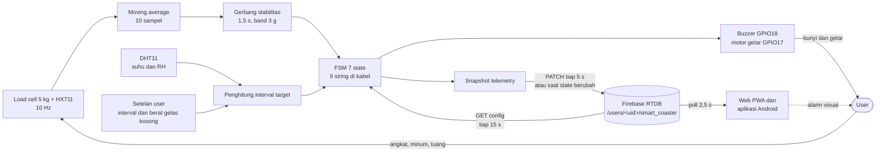

# Smart Hydration Coaster, garis besar sistem

Dokumen ini untuk teman yang mau paham cara kerja tatakan gelas pintar ini tanpa membaca kode satu per satu. Angka di bawah saya ambil langsung dari repo: `SmartHydrationCoaster/` (firmware ESP32), `web/` (dashboard PWA dan viewer 3D), `app/` (aplikasi Android Flutter), dan `tools/` (skrip uji).

## 1. Yang dikerjakan alat ini

Tatakan ini menimbang gelas, menghitung berapa mililiter air yang sudah diminum, lalu membunyikan buzzer dan menggetarkan motor kalau pemakainya terlalu lama tidak minum. Alat tidak menyiram apa pun dan tidak menuang air.

Karena itu, penutup lingkar kendalinya tetap manusia. Firmware hanya bisa memberi alarm; yang mengangkat gelas dan minum adalah orangnya. Untuk mata kuliah Sistem Kendali, susunannya jadi begini: massa air di gelas adalah plant, load cell adalah sensor umpan balik, dan manusia berada di dalam lingkar. Sistemnya closed-loop dengan human-in-the-loop.

Model kasarnya, air yang berkurang adalah proses akumulasi, jadi plant-nya integrator murni:

$$G_p(s) = \frac{\Delta M(s)}{Q_{out}(s)} = -\frac{1}{s}$$

Respons orang terhadap alarm saya dekati sebagai first-order plus dead time:

$$G_h(s) = \frac{K_h e^{-\theta s}}{\tau_h s + 1}$$

$K_h$ adalah kepatuhan minum setelah alarm, $\theta$ jeda kognitif sampai gelas diangkat, dan $\tau_h$ lama gerakan minum. Target kendalinya sederhana: massa air turun minimal 20 g dalam satu interval.

## 2. Aliran data



Gerbang stabilitas wajib ada. Tanpa gerbang itu, gelas yang diangkat bertahap (turun sekitar 46 g per sampel pada laju 10 Hz) terbaca sebagai minum palsu, timer terus ter-reset, dan baseline ikut rusak.

## 3. Perangkat keras

| Komponen | Koneksi | Catatan |
| :--- | :--- | :--- |
| Load cell 5 kg + HX711 | DT GPIO16, SCK GPIO4 | Dibaca 10 Hz, faktor kalibrasi 450,7 count/g |
| DHT11 | GPIO19 | Dibaca tiap 2 detik |
| Buzzer aktif, transistor PNP S8550 | GPIO18, aktif LOW | VCC wajib 3V3, bukan 5V |
| Motor getar, transistor NPN S8050 | GPIO17, aktif HIGH | VCC 5V aman karena emitor mereferensi GND |
| LED onboard (tidak dipakai) | GPIO2 | Hanya ada di sebagian board. Firmware masih menulis ke pin ini, tetapi kit ini tidak memakai LED sebagai indikator |

Satu jebakan listrik yang sempat kena: kalau VCC modul buzzer disambung ke 5V, tegangan emitor-basis jadi $V_{EB} = 5{,}0 - 3{,}3 = 1{,}7$ V, jauh di atas 0,7 V. Buzzer langsung menyala terus dan tidak bisa dimatikan lewat GPIO.

Semua aktuator lewat helper `writeActuator()`, tidak ada `digitalWrite()` langsung di logika utama. Polaritas aktif LOW dan aktif HIGH jadi terpusat di satu tempat.

## 4. Logika inti, 7 state dan 9 string

| Enum internal | String yang dikirim | Arti |
| :--- | :--- | :--- |
| `STATE_IDLE` | `IDLE` | Tatakan kosong, gelas tidak terdeteksi |
| `STATE_STABLE` | `STABLE` | Gelas ada, berat sudah stabil |
| `STATE_TIMING` | `TIMING` | Hitung mundur interval minum berjalan |
| `STATE_LIFTED` | `LIFTED` | Gelas diangkat, batas 3 menit (mode demo 10 detik) |
| `STATE_ALERT_DRINK` | `ALERT_DRINK` | Alarm waktunya minum, aktuator toggle tiap 500 ms |
| `STATE_ALERT_CHEAT` | `ALERT_CHEAT` | Curang terdeteksi, toggle tiap 150 ms |
| `STATE_ALERT_REFILL` | `ALERT_EMPTY_CUP` atau `ALERT_MISSING_CUP` | Isi ulang atau kalibrasi, toggle tiap 750 ms |

Ada satu flag tambahan, `missingCupAlert`. Flag itulah yang memilih antara dua string terakhir, jadi enum punya 7 nilai tapi kabel melihat 9 string. Keduanya tetap satu state, bukan dua.

Web menangani pemisahan ini secara eksplisit: `ALERT_MISSING_CUP` dipulihkan jadi `state = ALERT_REFILL` dengan `missing = true`, `ALERT_EMPTY_CUP` dengan `missing = false` (`web/index.html:723` dan `:849`). Tanpa pemetaan itu, state yang diterima dashboard tidak akan cocok dengan nama yang dipakai kelas `CoasterFSM`.

Aturan yang membuat angkanya jujur:

Gelas dianggap hadir saat berat 35 g ke atas, dan dianggap diangkat saat 25 g ke bawah. Jeda 10 g itu hysteresis, supaya pembacaan yang bergolak di sekitar ambang tidak membuat state bolak-balik.

Baseline tidak diperbarui selama `ALERT_CHEAT`. Kalau pemakai curang lalu benar-benar minum, selisihnya tetap dihitung terhadap baseline awal, jadi total harian tidak bisa dikurangi dengan cara curang.

Baseline hanya ditimpa saat isi ulang sah, yaitu kenaikan 30 g ke atas. Isi ulang yang baru dituang dicatat sebagai pending dulu; kalau berat kembali ke baseline pra-isi-ulang dalam 5 detik, isi ulang dibatalkan. Load cell tidak bisa membedakan tuangan dari tekan-lepas gelas, tapi tuangan tidak akan pernah kembali ke berat lama, jadi pembedaannya dilakukan lewat perilaku waktu.

Kalibrasi saat state aktif memaksa `STATE_ALERT_REFILL` dan menyelaraskan baseline ke berat aktual lebih dulu, supaya air yang sudah ada di gelas tidak terhitung sebagai isi ulang.

Buzzer yang diheningkan tidak mematikan motor. Keduanya memakai pola toggle yang sama, hanya buzzer yang dipaksa mati. Pin LED onboard di GPIO2 ikut ditoggle, tetapi tidak dipakai sebagai indikator di kit ini.

## 5. Timer adaptif

Interval pengingat punya dua mode. Mode manual: user menetapkan $T_{base}$ antara 1 sampai 180 menit, dan interval dikunci di angka itu. Mode otomatis: interval dasar dikalikan faktor suhu dan kelembaban ruang.

$$T_{target} = \max\left(5000\ \text{ms},\ \text{round}\left(T_{base} \times k_{temp}(T) \times k_{hum}(RH)\right)\right)$$

| Kondisi ruang | $k_{temp}$ | $k_{hum}$ | $T_{target}$ kalau $T_{base}$ 30 menit |
| :--- | :--- | :--- | :--- |
| Dingin, $T \le 18^\circ$C | 1,20 | 1,00 | 36,0 menit |
| Sejuk, $T = 22^\circ$C | 1,10 | 1,00 | 33,0 menit |
| Normal, $T = 26^\circ$C | 1,00 | 1,00 | 30,0 menit |
| Hangat, $T = 30^\circ$C | 0,75 | 1,00 | 22,5 menit |
| Panas, $T \ge 34^\circ$C | 0,50 | 1,00 | 15,0 menit |
| Kering, $RH \le 30\%$ | 1,00 | 0,85 | 25,5 menit |

Interpolasinya linier sepotong-sepotong dan kontinu, tanpa lompatan diskrit. Alasannya praktis: DHT11 bergolak sekitar 0,1 derajat, dan kalau fungsinya berbentuk tangga, fluktuasi sekecil itu bisa menggeser jadwal. Kalau DHT11 mengembalikan NaN, kontroler mempertahankan $T_{target} = T_{base}$ sebagai fail-safe.

## 6. Protokol komunikasi

Ada tiga media dan lima jalur.

| Jalur | Media | Arah | Ritme | Isi |
| :--- | :--- | :--- | :--- | :--- |
| Serial USB | UART 115200 baud | Dua arah | Baris telemetry tiap 500 ms, perintah saat user mengetik | State, berat, ml air, suhu, RH, sisa waktu, hitungan minum, curang, isi ulang, mode |
| Firmware ke cloud | Wi-Fi STA 2,4 GHz, HTTPS REST | Firmware ke RTDB | PATCH tiap 5 s, atau segera saat state berubah | 12 field JSON |
| Firmware baca config | Sama | RTDB ke firmware | GET tiap 15 s | Mode timer, interval manual, mute, berat gelas kosong |
| Web PWA | Browser ke RTDB | Dua arah | Poll 2,5 s, push dibatasi minimal 3 s | Telemetry, config, riwayat harian |
| Aplikasi Android | HTTP | Dua arah | Poll 2,5 s | Baca telemetry dan config, tulis config |

### 6.1 Serial USB

Firmware mencetak satu baris telemetry tiap 500 ms:

```
State: TIMING | Berat: 212.4g | Air: 82.4ml | Suhu: 27.0C | RH: 60% | SisaWaktu: 1712s | Diminum: 350.0ml | Minum: 3x | Cheat: 0 | Refill: 1x | Target: 1800s | Mode: NORM-AUTO | Buzzer: ON
```

Perintah yang dikenali firmware, satu karakter diikuti argumen kalau perlu:

| Perintah | Fungsi |
| :--- | :--- |
| `t` | Tare titik nol tatakan |
| `c` | Simpan berat gelas kosong dari berat sekarang, ditolak kalau di luar 35 sampai 300 g |
| `e<gram>` | Set berat gelas kosong langsung |
| `i<menit>` | Atur interval dasar 1 sampai 180 menit, sekaligus mematikan mode demo |
| `d` | Toggle mode demo 15 detik |
| `m` | Toggle timer otomatis DHT11 versus manual |
| `q` | Toggle hening, buzzer mati tapi getar tetap jalan |
| `r` | Reset statistik harian |
| `w<ssid>\|<pass>` | Simpan dan sambungkan Wi-Fi |
| `f<url>` | Simpan URL Firebase RTDB, wajib diawali `https://` |

Wi-Fi dan URL Firebase disimpan di NVS, jadi tidak hilang saat board reboot. Perintah `w` dan `f` membaca sisa baris sampai newline, karena itu di browser keduanya dikirim dengan `\n` di belakang.

### 6.2 Struktur Firebase RTDB

Node disimpan per akun, `/users/<uid>/smart_coaster`, dengan tiga anak:

```
/users/<uid>/smart_coaster
  telemetry.json        firmware menulis, web dan app membaca
  config.json           web dan app menulis, firmware membaca
  daily/<tanggal>.json  web menulis sebagai arsip harian
```

UID diambil dari respons login Firebase dan ikut di path, bukan hanya di token. Aturan RTDB membandingkan `auth.uid` dengan `$uid`, jadi akun lain tidak bisa membaca maupun menulis ke node ini meski tahu UID-nya.

Bedanya PATCH dan PUT penting di sini. PATCH melakukan merge per field pada node tujuan, sedangkan PUT menimpa node itu seluruhnya. Semua penulisan di proyek ini memakai PATCH, jadi menulis `config.json` tidak menghapus `telemetry.json` dan sebaliknya. Kalau salah satu sisi memakai PUT, isi node lain ikut lenyap.

Payload telemetry dari firmware:

```json
{
  "weight_g": 212.4,
  "water_ml": 82.4,
  "temp_c": 27.0,
  "humidity_pct": 60,
  "fsm_state": "TIMING",
  "remaining_sec": 1712,
  "target_interval_min": 30.00,
  "total_ml": 350.0,
  "drink_count": 3,
  "refill_count": 1,
  "cheat_count": 0,
  "muted": false
}
```

Node config yang ditulis web dan aplikasi Android:

```json
{
  "timer_mode": "AUTO_DHT",
  "manual_interval_min": 30,
  "empty_cup_weight_g": 130,
  "muted": false
}
```

Firmware membaca node config sebagai teks lalu mencocokkan potongan string (`"AUTO_DHT"`, `"muted":true`) dan mengambil angka lewat `extractJsonFloat`. Tidak ada parser JSON penuh di sana. Begitu ada perubahan, firmware menghitung ulang interval adaptif lalu menyimpannya ke NVS.

### 6.3 Siapa menulis apa

| Penulis | Node | Kapan |
| :--- | :--- | :--- |
| Firmware | `telemetry.json` | Tiap 5 detik, atau langsung saat string state berubah. Dilewati total kalau Wi-Fi belum tersambung |
| Firmware | Baca `config.json` | Tiap 15 detik |
| Web PWA | `config.json` | Saat tombol mode, mute, interval, atau berat gelas kosong ditekan |
| Web PWA | `telemetry.json` | Saat mode USB Live (mengikuti baris serial, dibatasi 3 detik) dan saat tombol reset ditekan |
| Web PWA | `daily/<tanggal>.json` | Bersamaan dengan push telemetry |
| Aplikasi Android | `config.json` | Saat mode timer, mute, atau interval diubah |

Ada dua penulis di node telemetry, firmware dan PWA dalam mode USB Live. Itu disengaja: saat dashboard tersambung kabel, firmware tetap menulis tiap 5 detik dari Wi-Fi, sementara PWA menulis versi yang dibacanya dari serial. Nilainya sama karena sumbernya sama, hanya jitter-nya bisa beda sedikit.

Riwayat harian hanya ditulis web, tidak ada yang membacanya kembali dari RTDB. Daftar "hari ini" di dashboard diambil dari `localStorage` browser, dan aplikasi Android menampilkan penghitung hari ini langsung dari node telemetry. Aplikasi hanya menyimpan URL RTDB di `SharedPreferences`.

### 6.4 Akun, keamanan, dan waktu

Akses RTDB butuh akun. Tiap pengguna mendaftar dengan email dan password lewat Firebase Authentication, lalu browser atau aplikasi menukar kredensial itu jadi ID token. Token ditempel ke setiap request sebagai `?auth=...`, dan UID dari respons login ikut masuk ke path `/users/<uid>/...`.

Aturan RTDB membandingkan UID di path dengan `auth.uid`:

```json
{
  "rules": {
    "users": {
      "$uid": {
        ".read": "auth != null && auth.uid === $uid",
        ".write": "auth != null && auth.uid === $uid"
      }
    }
  }
}
```

Artinya akun lain tidak bisa membaca maupun menulis ke node ini meski tahu UID pemiliknya. Tanpa aturan itu, siapa pun yang membuka halaman bisa menimpa data coaster orang lain, termasuk mematikan alarm.

Firmware memakai akun yang sama. Email dan password ditulis di `config.h`, lalu ditukar jadi token saat boot. Masa berlaku token satu jam, jadi firmware menyimpan refresh token di NVS dan memperpanjangnya sendiri tanpa perlu password lagi, dipicu lima menit sebelum kedaluwarsa.

Cap kedaluwarsa sengaja di-reset ke nol setiap boot. `millis()` kembali ke nol saat board menyala ulang, jadi cap yang disimpan dari boot sebelumnya tidak bisa dipercaya; tanpa reset itu firmware akan mengira token lama masih sah sampai sekitar 55 menit. Kalau refresh maupun login gagal, firmware mencetak alasannya ke serial dan berhenti mengirim data, bukan diam-diam menulis tanpa izin.

Firmware tetap memakai `client.setInsecure()`, jadi sertifikat TLS tidak divalidasi. Untuk tugas kuliah ini cukup, tapi untuk perangkat yang benar-benar dipasang di rumah orang lain, ganti dengan root CA yang dipasang eksplisit.

Firmware tidak melakukan sinkronisasi waktu; tidak ada NTP di sana. Akibatnya `remaining_sec` selalu relatif terhadap timer yang sedang jalan, bukan jam dinding. Kunci tanggal untuk `daily/<tanggal>.json` diambil dari jam perangkat yang menjalankan browser.

Aplikasi Android hanya mendukung mode cloud. Perintah `c` dan `t` tetap jalur USB saja, karena keduanya butuh berat aktual yang hanya terlihat dari serial.

### 6.5 Tiga mode koneksi di web

Dashboard punya tiga sumber data, dan ketiganya memakai kelas `CoasterFSM` yang sama.

Simulator menjalankan FSM JavaScript sepenuhnya di browser, tanpa perangkat. Ada 8 tombol skenario dan pilihan laju waktu 1, 10, 60, atau 600 kali untuk mempercepat demo di kelas.

USB Live memakai Web Serial API pada 115200 baud. Baris telemetry diparse jadi nilai tampilan, dan perintah dikirim balik lewat port yang sama. Butuh Chrome atau Edge; Firefox dan Safari belum mendukung Web Serial.

Cloud Firebase hanya melakukan poll ke RTDB tiap 2,5 detik, tanpa WebSocket, jadi tidak ada update push.

Halaman `web/casing_3d.html` terpisah dari dashboard. Isinya viewer Three.js untuk casing, murni visual, tanpa koneksi ke perangkat.

## 7. Tiga port, satu logika

FSM dan kontroler adaptif ditulis tiga kali: C++ di firmware (`fsm.h`, `adaptive_controller.h`), Python di `test_simulation.py`, dan JavaScript di `web/fsm.js`. Ketiganya harus identik secara fungsional, termasuk nilai ambang. Konstanta di `config.h` jadi satu-satunya sumber angka, dan `adaptive_controller.h` mengambil faktor dari sana, bukan menyalin ulang.

Ini yang membuat hasil simulasi web bisa dipercaya sebagai cermin perilaku perangkat asli, dan membuat regresi ketahuan tanpa harus menyalakan board.

## 8. Status pengujian

| Pemeriksaan | Hasil |
| :--- | :--- |
| Uji C++ di PC (`tools/uji_fsm`) | 52 pemeriksaan, 0 gagal |
| Simulasi Python (`test_simulation.py`) | 21 skenario lulus |
| Simulasi web (`node web/fsm.test.js`) | 30 asersi untuk 4 skenario regresi K1 dan K3 |
| Pemeriksaan tumpukan CAD (`tools/cad_check/verify_stackup.py`) | 60 pemeriksaan lulus |
| Aplikasi Android (`app/test`) | 18 uji (7 widget, 11 unit). Belum dijalankan di mesin ini karena Flutter tidak terpasang |

Program uji C++ mengompilasi `fsm.h` dan `adaptive_controller.h` yang asli, dengan `Arduino.h` tiruan di folder yang sama, jadi yang diuji memang kode yang dipakai firmware.

Pengukuran perangkat keras dengan beban acuan 500,0 g: rata-rata terbaca 500,10 g, rentang 499,98 sampai 500,19 g, jitter peak-to-peak 0,21 g. Band stabilitas sistem adalah $\pm 3$ g, jadi derau itu masih jauh di bawah band yang dipakai FSM.
