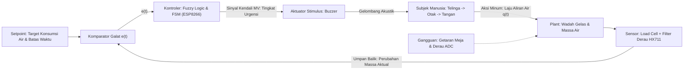

# Pemodelan Akademis Sistem Kendali: Tatakan Pengingat Hidrasi Cerdas

Dokumen ini memuat landasan teori dan pemodelan teknik kendali untuk proyek Tatakan Cerdas (Smart Coaster). Dokumen ini ditujukan untuk penyusunan laporan praktikum, laporan tugas besar, atau bahan pertanggungjawaban ilmiah di hadapan dosen penguji sistem kendali.

---

## 1. Klasifikasi Sistem: Human-in-the-Loop (HITL)

Secara umum, sistem kendali terbagi menjadi dua kelompok:
1. **Sistem Kendali Otomatis Murni:** Kontroler menggerakkan aktuator fisik (seperti motor, pemanas, atau pompa) yang secara langsung memanipulasi variabel proses tanpa campur tangan manusia.
2. **Sistem Kendali Human-in-the-Loop (HITL):** Manusia berperan sebagai bagian aktif di dalam lingkaran umpan balik, baik sebagai pengambil keputusan (*decision maker*) maupun sebagai aktuator fisik (*physical executor*).

Pada proyek ini, mikrokontroler tidak menuangkan air ke mulut pengguna secara otomatis. Mikrokontroler membangkitkan stimulus peringatan terukur untuk menggerakkan respon motorik manusia. Oleh karena itu, sistem ini diklasifikasikan secara formal sebagai **Sistem Kendali Tertutup Human-in-the-Loop (Closed-Loop HITL Control System)**.

---

## 2. Identifikasi Variabel Kendali

Untuk memenuhi kaidah formal diagram blok sistem kendali, komponen sistem didefinisikan sebagai berikut:

- **Variabel Proses (Process Variable / $PV$):** Massa air yang telah dikonsumsi pengguna dalam selang waktu pengamatan ($\Delta m$).
- **Nilai Rujukan (Setpoint / $SP$):** Target konsumsi air minimum dalam interval waktu tertentu (misal: $\Delta m \ge 150\text{ gram}$ per $2\text{ jam}$).
- **Sinyal Galat (Error / $e(t)$):** Selisih antara target konsumsi air dan konsumsi aktual:
  $$e(t) = SP(t) - PV(t)$$
- **Variabel Manipulasi (Manipulated Variable / $MV$):** Tingkat urgensi stimulus yang dihasilkan oleh algoritma kontroler fuzzy, diwujudkan dalam bentuk frekuensi ketukan dan nada buzzer.
- **Gangguan (Disturbance / $d(t)$):** 
  - Getaran mekanik pada meja kerja yang terbaca oleh load cell.
  - Derau listrik frekuensi rendah pada modul ADC 24-bit HX711.
  - Penguapan alami air ke udara bebas.
  - Aksi penambahan air (refill) oleh pengguna.

---

## 3. Diagram Blok Sistem Kendali

Diagram blok di bawah menggambarkan aliran sinyal umpan balik tertutup:

---

## 4. Pemodelan Matematis Dinamika Sistem

### A. Dinamika Wadah Air (Plant)
Plant fisik berupa air di dalam wadah dapat dimodelkan sebagai sistem akumulasi massa orde satu sederhana:
$$\frac{dm(t)}{dt} = q_{in}(t) - q_{out}(t) - q_{evap}(t)$$

Dengan asumsi tidak ada penambahan air ($q_{in} = 0$) dan laju penguapan dapat diabaikan dalam rentang jam ($q_{evap} \approx 0$), laju perubahan massa murni bergantung pada laju minum pengguna ($q_{out}(t)$):
$$m(t) = m_0 - \int_{0}^{t} q_{out}(\tau) d\tau$$

Dalam domain Laplace, transfer function pengurangan massa air terhadap laju konsumsi adalah fungsi integrator murni:
$$G_p(s) = \frac{\Delta M(s)}{Q_{out}(s)} = -\frac{1}{s}$$

### B. Pendekatan Dinamika Respon Manusia (Human Response Model)
Respon manusia terhadap stimulus suara alarm sering dimodelkan dalam rekayasa ergonomi kendali menggunakan pendekatan *First-Order Plus Dead Time* (FOPDT):
$$G_h(s) = \frac{K_h e^{-\theta s}}{\tau_h s + 1}$$

Keterangan parameter:
- $K_h$: Penguatan respon manusia (probabilitas pengguna mematuhi alarm).
- $\theta$: Waktu tunda kognitif (jarak waktu antara mendengar buzzer sampai pengguna mulai mengangkat gelas).
- $\tau_h$: Konstanta waktu aksi motorik (durasi meminum air hingga meletakkan gelas kembali).

---

## 5. Arsitektur Algoritma Kontroler Logika Fuzzy (FLC)

Untuk menghindari kelemahan logika threshold statis, sistem menggunakan *Fuzzy Logic Controller* tipe Sugeno orde-0.

### Variabel Masukan:
1. **Rasio Waktu ($T_r$):**
   $$T_r = \frac{t_{berjalan}}{t_{interval}}$$
   Fungsi Keanggotaan: *Singkat* (Short, 0.0 - 0.6), *Sedang* (Medium, 0.4 - 1.1), *Terlambat* (Late, 0.9 - 2.0+).
2. **Rasio Sisa Air ($W_r$):**
   $$W_r = \frac{W_{sekarang}}{W_{awal}}$$
   Fungsi Keanggotaan: *Sedikit* (Low, 0.0 - 0.4), *Sedang* (Medium, 0.3 - 0.7), *Banyak* (High, 0.6 - 1.0).

### Aturan Inferensi (Rule Base):
- **R1:** JIKA Waktu *Singkat*, MAKA Urgensi = Rendah (20)
- **R2:** JIKA Waktu *Sedang* DAN Sisa Air *Sedikit*, MAKA Urgensi = Rendah (20)
- **R3:** JIKA Waktu *Sedang* DAN Sisa Air *Banyak*, MAKA Urgensi = Sedang (50)
- **R4:** JIKA Waktu *Terlambat* DAN Sisa Air *Sedikit*, MAKA Urgensi = Sedang (50)
- **R5:** JIKA Waktu *Terlambat* DAN Sisa Air *Banyak*, MAKA Urgensi = Tinggi (90)

### Defuzzifikasi:
Keluaran dihitung menggunakan rata-rata terbobot (*Weighted Average*):
$$Urgensi = \frac{\sum w_i \cdot z_i}{\sum w_i}$$

---

## 6. Uji Performa dan Analisis Hasil

Saat melakukan pengujian di hadapan penguji, gunakan parameter kuantitatif berikut:

1. **Efektivitas Filter Derau:**
   Bandingkan simpangan baku (*standard deviation*) antara data mentah HX711 dan data setelah melewati *Moving Average Filter*. Tunjukkan bahwa fluktuasi derau berhasil ditekan dari $\pm 4.5\text{ gram}$ menjadi $<\pm 0.5\text{ gram}$.
2. **Uji Transisi Status (FSM Robustness):**
   Tunjukkan bahwa mesin status tidak mengalami kesalahan logika saat menghadapi tiga skenario uji batas:
   - Gelas diangkat tepat saat hitung mundur selesai.
   - Penambahan air baru di tengah proses monitoring.
   - Gelas hanya diangkat selama 2 detik lalu diletakkan kembali tanpa diminum.
