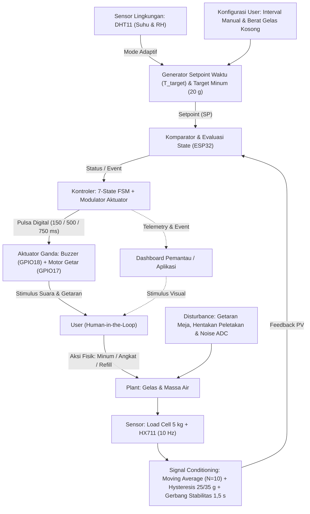

# Pemodelan Akademis Sistem Kendali: Smart Hydration Coaster

Dokumen ini memuat landasan teori dan pemodelan teknik kendali untuk proyek *Smart Hydration Coaster* berbasis ESP32. Dokumen ini disusun sebagai acuan laporan tugas besar dan pertanggungjawaban ilmiah pada mata kuliah RSK-352 Sistem Kendali dan RSK-354 *Internet of Things*.

---

## 1. Klasifikasi Sistem: *Human-in-the-Loop* (HITL)

Sistem kendali secara umum terbagi menjadi dua kelompok:
1. **Sistem Kendali Otomatis Murni:** Kontroler menggerakkan aktuator fisik seperti motor, pemanas, atau pompa yang secara langsung memanipulasi *process variable* tanpa intervensi manusia.
2. **Sistem Kendali *Human-in-the-Loop* (HITL):** Manusia berperan sebagai bagian aktif di dalam lingkar *feedback*, baik sebagai pengambil keputusan maupun sebagai eksekutor fisik.

Pada sistem ini, mikrokontroler ESP32 tidak menuangkan air secara mekanis, melainkan membangkitkan stimulus audio dan haptik terukur untuk memicu respon motorik *user* agar meminum air. Karena verifikasi aksi minum diukur kembali secara langsung oleh sensor massa (*load cell* + HX711) sebelum alarm dimatikan, sistem ini diklasifikasikan sebagai ***Closed-Loop Human-in-the-Loop Control System***.

---

## 2. Identifikasi Variabel Kendali

Komponen formal dalam diagram blok sistem kendali didefinisikan sebagai berikut:

- ***Process Variable* ($PV$):** Massa air aktual di dalam gelas ($W_{\text{air}} = W_{\text{total}} - W_{\text{kosong}}$) serta waktu tunggu sejak konsumsi terakhir ($t_{\text{elapsed}}$).
- ***Setpoint* ($SP$):** Pengurangan massa air minimum $\Delta W \ge 20\text{ g}$ dalam batas interval waktu target $T_{\text{target}}$ (bernilai dasar $30\text{ menit}$ pada mode normal atau kustom sesuai pengaturan *user*).
- ***Environmental Input*:** Suhu ruang ($T$, dalam $^\circ\text{C}$) dan kelembaban relatif ($RH$, dalam $\%$) dari sensor DHT11 yang memodulasi $T_{\text{target}}$ pada mode adaptif.
- **Sinyal *Error* ($e(t)$):** Selisih antara target pengurangan massa air pada saat batas waktu $T_{\text{target}}$ tercapai terhadap pengurangan massa aktual $\Delta W(t)$.
- ***Manipulated Variable* ($MV$):** Sinyal pulsa digital *on/off* pada dua aktuator (*active buzzer* PNP S8550 pada `GPIO18` dan modul motor getar NPN S8050 pada `GPIO17`) dengan periode denyut berbeda sesuai jenis peringatan (`500 ms` untuk `ALERT_DRINK`, `150 ms` untuk `ALERT_CHEAT`, dan `750 ms` untuk `ALERT_REFILL`).
- ***Disturbance* ($d(t)$):**
  - Getaran mekanik pada permukaan meja dan hentakan tangan saat meletakkan gelas.
  - *Noise* elektrik pada pembacaan ADC 24-bit HX711.
  - Penambahan massa air (*refill*) oleh *user*.

---

## 3. Diagram Blok Sistem Kendali

Diagram blok berikut menggambarkan aliran sinyal *closed-loop* sistem secara utuh:

---

## 4. Pemodelan Matematis Dinamika Sistem

### A. Dinamika Wadah Air (*Plant*)
*Plant* fisik berupa air di dalam gelas dimodelkan sebagai sistem akumulasi massa orde satu:
$$\frac{dm(t)}{dt} = q_{\text{in}}(t) - q_{\text{out}}(t) - q_{\text{evap}}(t)$$

Dengan mengabaikan laju penguapan dalam skala menit ($q_{\text{evap}} \approx 0$) dan di luar kejadian *refill* ($q_{\text{in}} = 0$), perubahan massa air murni bergantung pada laju konsumsi *user* ($q_{\text{out}}(t)$):
$$m(t) = m_0 - \int_{0}^{t} q_{\text{out}}(\tau)\,d\tau$$

Dalam domain Laplace, *transfer function* pengurangan massa air terhadap laju konsumsi adalah integrator murni:
$$G_p(s) = \frac{\Delta M(s)}{Q_{\text{out}}(s)} = -\frac{1}{s}$$

### B. Pendekatan Dinamika Respon Manusia (*Human Response Model*)
Respon *user* terhadap stimulus alarm suara dan getaran dimodelkan menggunakan pendekatan *First-Order Plus Dead Time* (FOPDT):
$$G_h(s) = \frac{K_h e^{-\theta s}}{\tau_h s + 1}$$

Parameter model:
- $K_h$: Penguatan kepatuhan *user* dalam meminum air setelah peringatan aktif.
- $\theta$: Waktu tunda kognitif antara aktifnya aktuator hingga *user* mengangkat gelas.
- $\tau_h$: Konstanta waktu aksi motorik saat meminum air hingga meletakkan gelas kembali ke tatakan.

---

## 5. Algoritma Penjadwalan Pewaktuan: Adaptif Kontinu DHT11 & Kustom *User*

Sistem menyediakan dua mode penentuan interval pengingat minum ($T_{\text{target}}$):

1. **Mode Kustom Manual (`MANUAL`):** *User* menetapkan langsung durasi interval pengingat dasar $T_{\text{base}} \in [1,\ 180]\text{ menit}$ melalui *dashboard* aplikasi atau perintah *serial* `i<menit>`, dan kontroler mengunci $T_{\text{target}} = T_{\text{base}}$.
2. **Mode Otomatis Adaptif Kontinu (`AUTO_DHT`):** Kontroler pada [`adaptive_controller.h`](file:///d:/Kuliah/Sistem%20Kendali/SmartHydrationCoaster/adaptive_controller.h) memodulasi interval dasar pilihan *user* ($T_{\text{base}}$) secara kontinu menggunakan interpolasi linier sepotong-sepotong (*piecewise-linear interpolation*) terhadap suhu ruang ($T$) dan kelembaban relatif ($RH$) dari sensor DHT11:

$$T_{\text{target}} = \max\left(5000\text{ ms},\ \text{round}\!\left(T_{\text{base}} \times k_{\text{temp}}(T) \times k_{\text{hum}}(RH)\right)\right)$$

Fungsi pengali suhu $k_{\text{temp}}(T)$ didefinisikan secara kontinu tanpa lompatan diskrit (*step discontinuity*) agar fluktuasi pembacaan DHT11 sebesar $\pm 0{,}1\,^\circ\text{C}$ di sekitar titik ambang tidak memicu perubahan jadwal secara mendadak:

$$k_{\text{temp}}(T) = \begin{cases}
1{,}20, & T \le 18\,^\circ\text{C} \\
1{,}20 - 0{,}20 \times \dfrac{T - 18}{8}, & 18\,^\circ\text{C} < T \le 26\,^\circ\text{C} \\
1{,}00 - 0{,}50 \times \dfrac{T - 26}{8}, & 26\,^\circ\text{C} < T < 34\,^\circ\text{C} \\
0{,}50, & T \ge 34\,^\circ\text{C}
\end{cases}$$

Fungsi pengali kelembaban relatif $k_{\text{hum}}(RH)$ didefinisikan secara kontinu sebagai berikut:

$$k_{\text{hum}}(RH) = \begin{cases}
0{,}85, & RH \le 30\% \\
0{,}85 + 0{,}15 \times \dfrac{RH - 30}{20}, & 30\% < RH < 50\% \\
1{,}00, & RH \ge 50\%
\end{cases}$$

| Titik Jangkar Lingkungan | Nilai Parameter | Faktor Pengali | Contoh $T_{\text{target}}$ ($T_{\text{base}} = 30\text{ mnt}$) |
| :--- | :--- | :--- | :--- |
| Dingin Maksimum | $T \le 18\,^\circ\text{C},\ RH \ge 50\%$ | $k_{\text{temp}} = 1{,}20,\ k_{\text{hum}} = 1{,}00$ | $36{,}0\text{ menit}$ |
| Sejuk (Interpolasi) | $T = 22\,^\circ\text{C},\ RH \ge 50\%$ | $k_{\text{temp}} = 1{,}10,\ k_{\text{hum}} = 1{,}00$ | $33{,}0\text{ menit}$ |
| Ruang Normal | $T = 26\,^\circ\text{C},\ RH \ge 50\%$ | $k_{\text{temp}} = 1{,}00,\ k_{\text{hum}} = 1{,}00$ | $30{,}0\text{ menit}$ |
| Hangat (Interpolasi) | $T = 30\,^\circ\text{C},\ RH \ge 50\%$ | $k_{\text{temp}} = 0{,}75,\ k_{\text{hum}} = 1{,}00$ | $22{,}5\text{ menit}$ |
| Panas Maksimum | $T \ge 34\,^\circ\text{C},\ RH \ge 50\%$ | $k_{\text{temp}} = 0{,}50,\ k_{\text{hum}} = 1{,}00$ | $15{,}0\text{ menit}$ |
| Ruang Kering | $T = 26\,^\circ\text{C},\ RH \le 30\%$ | $k_{\text{temp}} = 1{,}00,\ k_{\text{hum}} = 0{,}85$ | $25{,}5\text{ menit}$ |

Apabila pembacaan sensor DHT11 menghasilkan nilai tidak valid (`NaN`), kontroler otomatis mempertahankan $T_{\text{target}} = T_{\text{base}}$ sebagai mekanisme *fail-safe*.

---

## 6. Hasil Pengukuran dan Verifikasi Perangkat Keras

Pengujian langsung pada perangkat keras ESP32 + *load cell* 5 kg + HX711 + DHT11 menghasilkan data terukur sebagai berikut:

1. **Kalibrasi dan Stabilitas Sinyal Statis (`run_noise_test`):**
   - Faktor kalibrasi terukur pada beban acuan $500{,}0\text{ g}$: **`450.7f`** *count*/gram.
   - Dari $20$ sampel statis berturut-turut pada beban $500{,}0\text{ g}$, diperoleh:
     - Rata-rata pembacaan: **`500.10 g`** (*steady-state error* $+0{,}10\text{ g}$ atau $0{,}02\%$).
     - Nilai minimum: **`499.98 g`**; nilai maksimum: **`500.19 g`**.
     - *Peak-to-Peak Jitter*: **`0.21 g`** ($\pm 0{,}105\text{ g}$), jauh di bawah pita stabilitas `STABILITY_BAND_G` ($\pm 3{,}0\text{ g}$).
2. **Ketahanan Mesin Status 7-*State* (FSM *Robustness*):**
   - **Gerbang Stabilitas Waktu ($1500\text{ ms}$, $\pm 3\text{ g}$):** Mencegah penurunan massa bertahap saat gelas sedang diangkat ($\approx 46\text{ g/sampel}$ pada laju $10\text{ Hz}$) terbaca sebagai konsumsi air palsu.
   - **Verifikasi *Anti-Cheat*:** Ketika gelas diangkat lalu diletakkan kembali dengan pengurangan massa $|\Delta W| < 20\text{ g}$ (teruji pada $\Delta W = -0{,}3\text{ g}$ dan $\Delta W = -18{,}5\text{ g}$), sistem mengunci *state* ke `STATE_ALERT_CHEAT` tanpa mengubah *baseline* massa awal.
   - **Verifikasi Konsumsi dan *Refill*:** Pengurangan massa stabil $\Delta W \ge 20\text{ g}$ (teruji pada $\Delta W = -45{,}3\text{ g}$) diakumulasikan secara akurat ke volume minum harian dan me-*reset* *timer* ke `STATE_TIMING`.
